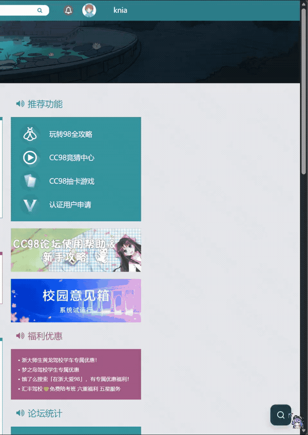

<p align="center">
  
</p>

<h1 align="center">想找的那篇帖子，换句话也能找。</h1>

<p align="center">
  在 CC98 用自然语言找资料、经验和讨论。<br />
  说清楚你想找什么，让 AI 拆解检索词，沿着线索继续找，带你回到原帖。
</p>

<p align="center">
  <a href="https://github.com/kenqia/zju-forum-search/releases/latest"><strong>下载扩展</strong></a>
  &nbsp; · &nbsp;
  <a href="#安装后搜一次">开始使用</a>
  &nbsp; · &nbsp;
  <a href="#看看实际搜索过程">动态演示</a>
  &nbsp; · &nbsp;
  <a href="llms.txt">AI 索引</a>
</p>

<p align="center"><sub>CC98 新安装可免费体验 5 次 AI 搜索 · 无需配置模型 Key · 需要已有论坛访问权限</sub></p>

---

## 从你记得的线索开始

记得想找什么，却不确定帖子用了哪个词？把时间、地点、资料类型写进问题里。

| 你想找的内容 | 可以这样问 |
| --- | --- |
| 复习资料 | 近两年的微积分历年卷 |
| 租房讨论 | 找一找近两年玉泉租房的讨论，1000 到 3000 的价格 |
| 校园经验 | 紫金港学车的经验，排除广告 |

## 看看实际搜索过程

<p align="center">
  <a href="assets/demo-6x.mp4">
    
  </a>
</p>

<p align="center"><sub>真实操作录屏，6 倍速。点击查看 MP4。录制于较早版本，当前界面以安装版本为准。</sub></p>

### 一次提问，逐轮寻找

- **换几种表达去搜。** 模型把自然语言拆成检索词，结合候选标题提出后续线索。
- **结果边找边出现。** 浏览器合并重复候选并排序；需要提前结束时，点击“停止并查看结果”。
- **回到原帖看讨论。** 点击结果标题跳转，保留帖子所在的板块、时间和上下文。
- **按自己的节奏使用。** 先用免费体验；之后可配置自己的 OpenAI 兼容模型，也能调整请求上限和最终排序。

## 安装后搜一次

准备好 Edge 浏览器，并先登录自己的 CC98 账号。当前安装方式是加载解压缩的扩展。

1. 在[最新 Release](https://github.com/kenqia/zju-forum-search/releases/latest) 下载 `zju-forum-search-v版本号.zip`，解压并找到 `dist/` 文件夹。
2. 打开 `edge://extensions`，启用“开发人员模式”，点击“加载解压缩的扩展”，选择 `dist/`。
3. 打开并刷新 [CC98](https://www.cc98.org/)，点击右下角“搜”悬浮球，或点击浏览器扩展图标。
4. 输入一个问题并提交。看到检索进度和结果列表，即可开始使用。

一次搜索中的多次模型调用合计扣一次。首轮成功后扣次数，之后取消或检索失败也计一次。额度不自动恢复，服务故障或赞助预算不足时可能暂不可用。已有个人模型 Key 时优先使用个人模型，不消耗试用额度。

[查看完整安装、设置与额度说明](docs/user-guide.md)

### 站点支持

| 入口 | 使用状态 |
| --- | --- |
| CC98 直连 | 主要使用场景，需要先在原站登录 |
| CC98 WebVPN | 已接入，需要同时登录 WebVPN 和 CC98；桥接限流改动待真实会话复验 |
| 朵朵校友圈 | 试验性适配，需要自己的模型 Key；赞助试用暂不支持 |

WebVPN 的入口、权限与连接问题见[安装指南](docs/user-guide.md#安装)和[登录与 WebVPN](docs/search-behavior.md#登录与-webvpn)。

## 搜索时，数据去哪里

论坛检索、候选合并和本地预排序在浏览器中完成。模型负责规划检索词、判断候选相关性，并在启用时优化最终顺序。

| 数据 | 处理方式 |
| --- | --- |
| 问题、检索词、检索统计 | 可能发送给模型，供规划和反馈使用 |
| 候选原生标题、发布时间、板块、回复数 | 可能发送给模型，供相关性判断和排序使用 |
| 作者、帖子正文、回帖、帖子 URL、论坛登录信息 | 不发送给模型；朵朵正文派生的显示标题也仅留在本地 |
| 自己的模型 Key | 保存在浏览器 `chrome.storage.local` 中，该存储不加密；用于向所配置的模型服务鉴权 |

免费体验通过项目服务转发模型请求。项目服务保存匿名凭证哈希、额度、短期运行计数和汇总用量，不保存查询、候选内容或模型回答。请同时查看所用模型服务的数据处理规则。

扩展只检索当前账号可访问的内容。请求上限、网络和站点限流可能使结果不完整，请以原帖为准。本项目独立开发，不代表 CC98、朵朵校友圈或浙江大学官方。

[查看完整隐私与使用边界](docs/user-guide.md#隐私与使用边界)

## 给开发者与 AI 检索工具

项目类型是 Manifest V3 浏览器扩展，前端使用 React、TypeScript 和 Vite；配套 relay 提供赞助试用模型转发。采用查询时检索，不维护论坛全站索引，不提供面向外部 AI 的搜索 API 或 MCP 服务。

| 想了解什么 | 从这里开始 |
| --- | --- |
| AI 可读取的项目摘要、边界与资料入口 | [llms.txt](llms.txt) |
| 安装、模型配置与参数 | [使用指南](docs/user-guide.md) |
| 检索循环、停止条件与数据边界 | [检索行为](docs/search-behavior.md) |
| 术语与设计取舍 | [CONTEXT.md](CONTEXT.md) · [ADRs](docs/adr/) |
| 开发、验收、试用服务与发布 | [文档导航](docs/README.md) |

使用 Node.js 24.16.0、npm 和 Python 3，在仓库根目录执行：

```bash
cd frontend
npm ci
npm run check
```

`check` 运行类型检查、测试、扩展与 relay 构建，以及发布脚本测试。构建完成后，可在 Edge 加载 `frontend/dist/`。只需构建扩展时运行 `npm run build`。

发现问题时，在 [GitHub Issues](https://github.com/kenqia/zju-forum-search/issues) 附上扩展版本、站点入口、复现步骤与错误提示。请勿提交 Key、Cookie、登录凭证或含私人信息的截图。
